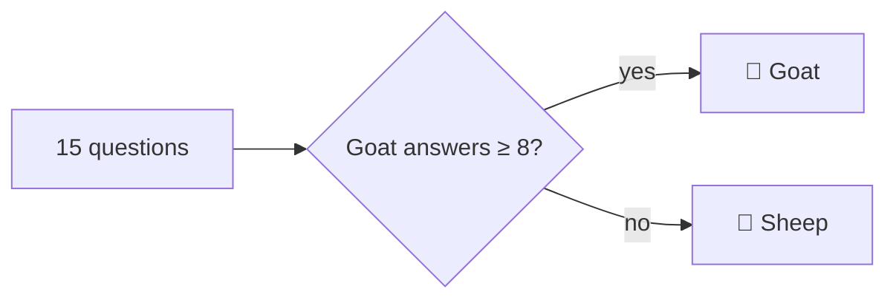

# Goat or Sheep Guide

## Requirements

- macOS 14 or later
- Xcode command-line tools (Swift 5.9+)

## Build and Open the App

```bash
./scripts/build-app.sh
open "build/Goat or Sheep.app"
```

You can also drag `build/Goat or Sheep.app` into `/Applications`. For a quick run during development, use `swift run GoatOrSheep`.

### Opening It on Another Mac

The app isn't notarized by Apple, so the first time someone else opens a copy, macOS says it can't check it for malicious software and won't open it. To allow it:

1. Click **Done** in that message.
2. Open **System Settings → Privacy & Security** and scroll down to Security.
3. Click **Open Anyway** next to the "Goat or Sheep" message, then confirm.

After that it opens normally.

## Open the Website

The live site is at https://amalmehta.github.io/goat-or-sheep/. It republishes on every push to `main` that changes `web/` (see `.github/workflows/website.yml`).

To run it locally:

The website lives in `web/` and needs no build step. Serve the folder so the icon loads:

```bash
python3 -m http.server 8321 --directory web
```

Then open http://localhost:8321. Any static host works: upload `web/index.html`, `web/quiz.js` and `web/icon.png` together.

In both the app and the website, the Feedback tab shows the email address and a **Copy Message** button as well as **Open Email**, for when no mail app is set up.

## Using It

1. Click **Take the Quiz**.
2. Answer fifteen questions. Click an answer or press **1–4**. Use **Back** to change your last answer.
3. The result screen shows whether you're a Goat or a Sheep, plus how many answers went each way. Click **Take It Again** to start over.

The **Feedback** button in the bottom-right corner opens a short form. **Open Email** starts a pre-filled draft in your mail app. Nothing is sent until you send it there. If you don't use a mail app, click **Copy Message** and paste it into an email to the address shown.

## How Scoring Works

Every question has two goat answers and two sheep answers. There are fifteen questions, so there can't be a tie: eight or more goat answers makes you a Goat. The questions live in `Sources/GoatOrSheepKit/Quiz.swift`, with a copy in `web/quiz.js`. If you edit one, edit the other; `swift test` runs the website's copy and fails if its questions, results or scoring differ from the app's.



## Project Layout

| Path | What it is |
|---|---|
| `Sources/GoatOrSheepKit/` | Quiz questions, scoring and all the screens |
| `Sources/GoatOrSheep/` | The app entry point and window |
| `Sources/RenderScreenshots/` | Regenerates every README screenshot, Mac app and website |
| `Sources/RenderIcon/` | Draws the icon into `Resources/Icon.png` (app) and `web/icon.png` (website) |
| `web/` | The website version: `index.html` (the page), `quiz.js` (questions and scoring) and its icon |
| `Tests/` | Tests for scoring, quiz flow, the feedback email link, and that the website's questions and scoring match the app's |
| `scripts/build-app.sh` | Builds `build/Goat or Sheep.app` |

## Development

```bash
swift test
swift run -c release RenderScreenshots   # needs internet for the website's fonts; release is much faster
swift run RenderIcon                     # then rebuild the app to pick up the new icon
```

Run these from the repo root.
