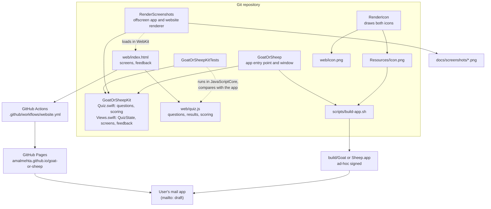
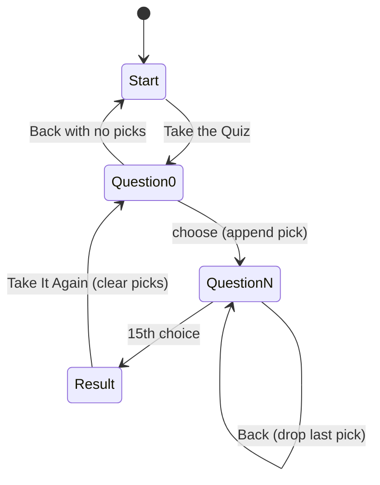

# Goat or Sheep System Design

Goat or Sheep is a fifteen-question personality quiz that ships two ways: a native Mac app and a single-page website. Both run entirely on the user's device. There is no server, no account and no stored data. The only thing that leaves the device is a feedback email, and only when the user sends it from their own mail app.

For setup and usage, see [GUIDE.md](GUIDE.md).

## Architecture

## Components

| Component | Path | Job |
|---|---|---|
| **GoatOrSheepKit** | `Sources/GoatOrSheepKit/` | The shared library. `Quiz.swift` holds the data model (`Animal`, `Answer`, `Question`, `QuizResult`), all fifteen questions and the `score` function. `Views.swift` holds `QuizState` (the screen state machine), every SwiftUI screen, the feedback sheet and `Feedback.mailURL`. Everything the app shows comes from here. |
| **GoatOrSheep** | `Sources/GoatOrSheep/GoatOrSheepApp.swift` | The executable. Creates one `QuizState`, opens a single window with `ContentView` (560×520 at least, and it can be made bigger), and passes in the feedback address. Its `AppDelegate` makes the process a regular foreground app (needed under `swift run`) and quits when the window closes. |
| **RenderScreenshots** | `Sources/RenderScreenshots/` | A dev tool. Renders `ContentView` offscreen for the start, question and result screens in light and dark, and loads `web/index.html` in an offscreen `WKWebView` at desktop (1200×760, 2×) and phone (390×844, 3×) sizes, light and dark. Writes every README image to `docs/screenshots/` with its own lossless PNG writer (`PNG.swift`), which converts to sRGB, drops the unused alpha channel and picks the best PNG filter per row, so the files are about 40% smaller than ImageIO's. |
| **RenderIcon** | `Sources/RenderIcon/main.swift` | A dev tool. Draws the goat-and-sheep-on-a-hill icon with SwiftUI shapes and writes it twice from the same drawing: 1024×1024 to `Resources/Icon.png` and 320×320 to `web/icon.png`. It doesn't depend on the kit. |
| **Build script** | `scripts/build-app.sh` | Builds the release binary, makes an `.icns` from `Resources/Icon.png` with `sips` and `iconutil`, writes `Info.plist` (bundle ID `com.amalmehta.goat-or-sheep`, macOS 14+), assembles `build/Goat or Sheep.app` and ad-hoc signs it. |
| **Website quiz data** | `web/quiz.js` | The website's copy of the quiz: `QUESTIONS`, `ANIMALS` (names, emoji, blurbs) and `score`. Plain JavaScript with no page code, so the tests can run it outside a browser. |
| **Website page** | `web/index.html`, `web/icon.png` | The page itself: inline CSS (light and dark via `prefers-color-scheme`, phone layout, reduced motion) and inline JavaScript for the screens, keyboard shortcuts and feedback panel. It loads `quiz.js` and fills in the question count on the start screen from it. No framework, no build step. |
| **Tests** | `Tests/GoatOrSheepKitTests/QuizTests.swift` | Checks every question has two goat and two sheep answers, the question count is odd, majority scoring, the `QuizState` flow including Back, and the encoding of the feedback `mailto:` link. It also runs `web/quiz.js` in JavaScriptCore and checks that its questions (order, text and animal), names, emoji, blurbs and `score` results for every possible goat count all match the app. |
| **Publish workflow** | `.github/workflows/website.yml` | On a push to `main` that touches `web/` (or by hand), uploads the `web/` folder as-is and deploys it to GitHub Pages. |

## Main Flows

### Taking the quiz

Both clients follow the same state machine. The app keeps it in `QuizState` (`screen` plus `picks: [Answer]`). The website keeps it in a `picks` array of `"goat"`/`"sheep"` strings and re-renders `#app` with `innerHTML` on each step.

- The current question index is always `picks.count`, so Back is just "remove the last pick".
- Keys **1–4** pick an answer: SwiftUI keyboard shortcuts in the app, a `keydown` listener in the browser (ignored while typing feedback).
- On the result screen, `score` counts goat picks. More than half makes a Goat, otherwise a Sheep. With fifteen questions there's never a tie. The tally bar shows the goat share.
- In the app, a question that doesn't fit the window scrolls instead of being cut off, and the window can be made bigger.

### Sending feedback

1. The user opens the Feedback tab (bottom-right) and types a message. Both versions show the address it goes to.
2. **Open Email** builds a `mailto:` link (subject "Goat or Sheep feedback", body percent-encoded). The app builds it with `URLComponents` and hands it to `NSWorkspace.open`. The website rewrites the link's `href` on every keystroke.
3. The user's mail app opens a draft. Nothing is sent until they send it.
4. If there's no mail app, **Copy Message** puts the text on the clipboard so it can be pasted anywhere. The app checks for a mail app before opening the link, and if there isn't one it keeps the sheet open and says so. A browser can't tell whether a mail app opened, so the website always shows a hint after **Open Email** is clicked. If the Clipboard API is missing or fails, it selects the text for a manual copy.

### Building and releasing

- **Mac app:** `./scripts/build-app.sh` → `build/Goat or Sheep.app`. There is no release channel; the bundle is built locally and opened or copied to `/Applications`. On another Mac, Gatekeeper asks once before opening it (see the guide).
- **Website:** push a change under `web/` to `main` → the workflow deploys `web/` to GitHub Pages. Pushes are serialized by the `pages` concurrency group, and a newer push cancels an older one in progress.
- **Changing questions:** edit `Quiz.swift` and `web/quiz.js`, then run `swift test`, which fails if the two disagree in any way. The website's question count updates itself. Re-run `swift run -c release RenderScreenshots` to refresh every README image.
- **Changing the icon:** edit `RenderIcon`, run `swift run RenderIcon` (writes both sizes), then rebuild the app.

## Where Data Lives

| Data | Where | Lifetime |
|---|---|---|
| Questions, answers, blurbs | Hard-coded in `Quiz.swift` and again in `web/quiz.js`, kept equal by tests | Source code |
| Quiz progress (`picks`) | App: `QuizState` in memory. Website: a JavaScript variable | Gone when the window or tab closes. Nothing is persisted, not even in `UserDefaults` or `localStorage` (see Key Decisions) |
| Feedback text | In memory until handed to the mail app as a `mailto:` URL or copied to the clipboard | The draft belongs to the user's mail app |
| Feedback address | `GoatOrSheepApp.swift` and `web/index.html` (twice: the visible address and the link) | Source code |
| App icon | Drawn by `RenderIcon` → `Resources/Icon.png` (1024 px) → `AppIcon.icns` in the bundle, and `web/icon.png` (320 px) | Committed |
| Screenshots | `docs/screenshots/`, all made by `RenderScreenshots` | Committed |
| Build output | `.build/`, `build/` | Git-ignored, disposable |

There is no analytics and there are no cookies. The only network requests are for the page, `quiz.js`, the icon and the Google Fonts it uses.

## Key Decisions

- **Swift Package Manager, no Xcode project.** The whole app is a `Package.swift` plus a shell script that wraps the binary into an `.app`. It keeps the repo small and buildable from the command line, at the cost of hand-writing `Info.plist`.
- **Logic and views in a library target.** `GoatOrSheepKit` is shared by the app, the screenshot renderer and the tests, so screenshots and tests exercise exactly the code users run.
- **Odd question count, two goat and two sheep answers per question.** Every question is balanced, and an odd total means there's never a tie. Tests enforce both rules.
- **A binary result, every answer counting equally.** You're a Goat or a Sheep, decided by majority. A weighted score or a "bit of both" result was considered and turned down to keep the quiz simple and decisive.
- **No saved progress.** The quiz takes about two minutes, so starting over is cheaper than the complexity of saving and restoring it. Past results aren't kept either.
- **Website as a hand-written copy, checked by running it.** One plain HTML page plus a small `quiz.js`, with no framework or build step, is easy to host and read. The quiz data is duplicated in Swift and JavaScript. Rather than generate one from the other, the tests load `quiz.js` in JavaScriptCore (built into macOS) and compare its data and scoring with the app's directly.
- **Feedback by `mailto:`, not a backend.** No server to run and no data collected. The user sees and sends the email themselves, with Copy Message as the fallback when there's no mail app.
- **Offscreen screenshots.** `RenderScreenshots` renders the app into a borderless window and the website into an offscreen WebKit view instead of capturing the screen, so every README image is reproducible and doesn't depend on window position or desktop.
- **Custom-drawn icon, one source.** The icon is drawn in code rather than using Apple emoji, which aren't licensed for icons. Emoji are still used inside the app. Both icon sizes come from the same drawing.
- **Ad-hoc code signing, no notarization.** Enough to run locally without a paid Apple Developer ID. Anyone else opening the app approves it once in System Settings, as the guide explains.
- **GitHub Pages via Actions.** Deploys straight from `web/`, so the published site is exactly what's in the repo.

## Known Limits

- **The website's screen flow is written twice.** The quiz data and scoring are checked against the app, but the start, question and result screens and Back are separate code in `Views.swift` and `web/index.html`. Both follow the same simple rule (the current question is `picks.count`), but no test compares them.
- **Screenshots need a release build to be quick.** The PNG writer is plain Swift, so in a debug build `RenderScreenshots` takes several minutes; with `-c release` it takes under half a minute.
- **Website screenshots need the network.** The page loads its fonts from Google Fonts, so `RenderScreenshots` needs an internet connection, and it fails rather than save images in a fallback font.
- **Website screenshots show Safari's rendering.** They're drawn by WebKit, so they show the page as Safari draws it, not Chrome or Firefox.
- **Opening the app on another Mac takes one extra step.** Without notarization, Gatekeeper blocks the first launch until the user allows it in System Settings. There's no auto-update.
- **English only, macOS 14+ only.** No localization, and the app needs macOS 14 or later.
