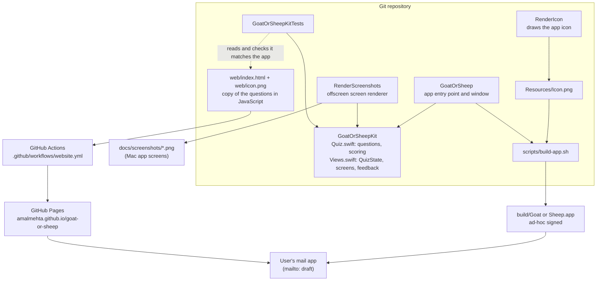
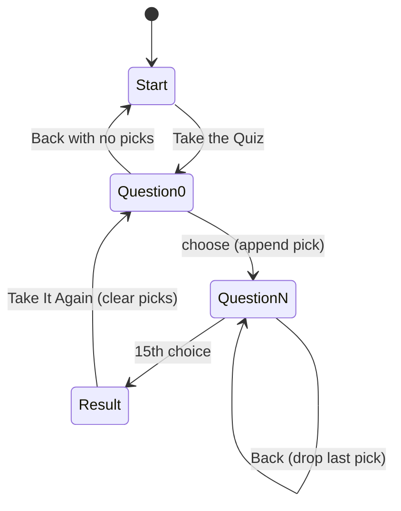

# Goat or Sheep System Design

Goat or Sheep is a fifteen-question personality quiz that ships two ways: a native Mac app and a single-page website. Both run entirely on the user's device. There is no server, no account and no stored data. The only thing that leaves the device is a feedback email, and only when the user sends it from their own mail app.

For setup and usage, see [GUIDE.md](GUIDE.md).

## Architecture

## Components

| Component | Path | Job |
|---|---|---|
| **GoatOrSheepKit** | `Sources/GoatOrSheepKit/` | The shared library. `Quiz.swift` holds the data model (`Animal`, `Answer`, `Question`, `QuizResult`), all fifteen questions and the `score` function. `Views.swift` holds `QuizState` (the screen state machine), every SwiftUI screen, the feedback sheet and `Feedback.mailURL`. Everything the app shows comes from here. |
| **GoatOrSheep** | `Sources/GoatOrSheep/GoatOrSheepApp.swift` | The executable. Creates one `QuizState`, opens a single fixed-size window with `ContentView`, and passes in the feedback address. Its `AppDelegate` makes the process a regular foreground app (needed under `swift run`) and quits when the window closes. |
| **RenderScreenshots** | `Sources/RenderScreenshots/main.swift` | A dev tool. Builds `QuizState`s for the start, question and result screens, renders `ContentView` offscreen in light and dark appearance, and writes PNGs to `docs/screenshots/`. |
| **RenderIcon** | `Sources/RenderIcon/main.swift` | A dev tool. Draws the goat-and-sheep-on-a-hill icon with SwiftUI shapes and writes a 1024×1024 `Resources/Icon.png`. It doesn't depend on the kit. |
| **Build script** | `scripts/build-app.sh` | Builds the release binary, makes an `.icns` from `Resources/Icon.png` with `sips` and `iconutil`, writes `Info.plist` (bundle ID `com.amalmehta.goat-or-sheep`, macOS 14+), assembles `build/Goat or Sheep.app` and ad-hoc signs it. |
| **Website** | `web/index.html`, `web/icon.png` | One self-contained page: inline CSS (light and dark via `prefers-color-scheme`, phone layout, reduced motion) and inline JavaScript with its own copy of the questions, blurbs, scoring and screen logic. No framework, no build step. |
| **Tests** | `Tests/GoatOrSheepKitTests/QuizTests.swift` | Checks every question has two goat and two sheep answers, the question count is odd, majority scoring, the `QuizState` flow including Back, the encoding of the feedback `mailto:` link, and that `web/index.html` contains every app question, answer, animal and blurb, plus the right question count. |
| **Publish workflow** | `.github/workflows/website.yml` | On a push to `main` that touches `web/` (or by hand), uploads the `web/` folder as-is and deploys it to GitHub Pages. |

## Main Flows

### Taking the quiz

Both clients follow the same state machine. The app keeps it in `QuizState` (`screen` plus `picks: [Answer]`). The website keeps it in a `picks` array of `"goat"`/`"sheep"` strings and re-renders `#app` with `innerHTML` on each step.

- The current question index is always `picks.count`, so Back is just "remove the last pick".
- Keys **1–4** pick an answer: SwiftUI keyboard shortcuts in the app, a `keydown` listener in the browser (ignored while typing feedback).
- On the result screen, `score` counts goat picks. More than half makes a Goat, otherwise a Sheep. With fifteen questions there's never a tie. The tally bar shows the goat share.

### Sending feedback

1. The user opens the Feedback tab (bottom-right) and types a message.
2. The app builds a `mailto:` URL with `URLComponents` (subject "Goat or Sheep feedback", body percent-encoded) and hands it to `NSWorkspace.open`. The website rewrites the **Open Email** link's `href` on every keystroke.
3. The user's mail app opens a draft. Nothing is sent until they send it.
4. Because some browsers have no mail handler, the website also shows the address and a **Copy Message** button, which falls back to selecting the text when the Clipboard API is missing or fails.

### Building and releasing

- **Mac app:** `./scripts/build-app.sh` → `build/Goat or Sheep.app`. There is no release channel; the bundle is built locally and opened or copied to `/Applications`.
- **Website:** push a change under `web/` to `main` → the workflow deploys `web/` to GitHub Pages. Pushes are serialized by the `pages` concurrency group, and a newer push cancels an older one in progress.
- **Changing questions:** edit `Quiz.swift` and the `QUESTIONS` array in `web/index.html` (and the "15 questions" text on the start screen if the count changes), then run `swift test`, which fails if the two disagree. Re-run `RenderScreenshots` to refresh the README images.

## Where Data Lives

| Data | Where | Lifetime |
|---|---|---|
| Questions, answers, blurbs | Hard-coded in `Quiz.swift` and again in `web/index.html` | Source code |
| Quiz progress (`picks`) | App: `QuizState` in memory. Website: a JavaScript variable | Gone when the window or tab closes. Nothing is persisted, not even in `UserDefaults` or `localStorage` |
| Feedback text | In memory until handed to the mail app as a `mailto:` URL | The draft belongs to the user's mail app |
| Feedback address | `GoatOrSheepApp.swift` and `web/index.html` (twice: the visible address and the link) | Source code |
| App icon | `Resources/Icon.png` (1024 px, generated) → `AppIcon.icns` in the bundle. `web/icon.png` is a separate 320 px copy | Committed |
| Screenshots | `docs/screenshots/`. Mac app images come from `RenderScreenshots`; the `website*.png` images were captured separately | Committed |
| Build output | `.build/`, `build/` | Git-ignored, disposable |

There is no analytics, no cookies and no network request beyond loading the page and its icon.

## Key Decisions

- **Swift Package Manager, no Xcode project.** The whole app is a `Package.swift` plus a shell script that wraps the binary into an `.app`. It keeps the repo small and buildable from the command line, at the cost of hand-writing `Info.plist`.
- **Logic and views in a library target.** `GoatOrSheepKit` is shared by the app, the screenshot renderer and the tests, so screenshots and tests exercise exactly the code users run.
- **Odd question count, two goat and two sheep answers per question.** Every question is balanced, and an odd total means there's never a tie. Tests enforce both rules.
- **Website as a hand-written copy, not a port or shared source.** One plain HTML file with no framework or build step is easy to host and read. The price is duplicated content, which `testWebsiteQuestionsMatchApp` guards by searching the HTML for each question and answer.
- **Feedback by `mailto:`, not a backend.** No server to run and no data collected. The user sees and sends the email themselves.
- **Offscreen screenshots.** `RenderScreenshots` renders `ContentView` into a borderless window instead of capturing the screen, so README images are reproducible and don't depend on window position or desktop.
- **Custom-drawn icon.** The icon is drawn in code rather than using Apple emoji, which aren't licensed for icons. Emoji are still used inside the app.
- **Ad-hoc code signing.** Enough to run locally without a paid developer account.
- **GitHub Pages via Actions.** Deploys straight from `web/`, so the published site is exactly what's in the repo.

## Known Limits

- **Two copies of the quiz.** Questions, blurbs and the scoring rule exist in Swift and JavaScript. The test catches text drift but not logic drift: a change to `score` or the screen flow in one place won't fail anything in the other. The test also relies on the exact `["prompt", [` and `["text", "animal"]` formatting in the HTML.
- **Hard-coded question count on the website.** The start screen's "15 questions" text is static; the test checks it, but it must be edited by hand.
- **Fixed window size.** The app window is 560×520 and not resizable. A much longer question or answer could clip.
- **No persistence.** Closing the window or tab mid-quiz loses progress, and past results aren't kept.
- **Unsigned for distribution.** The `.app` is ad-hoc signed and not notarized, so on another Mac Gatekeeper will block it until the user allows it. There's no auto-update.
- **Feedback depends on a mail client.** If none is set up, the app's **Open Email** may do nothing visible. The website has the copy fallback; the app doesn't.
- **Icon has two sources.** `web/icon.png` isn't generated from `Resources/Icon.png` by any script, so a redrawn icon must be copied and resized by hand.
- **Website screenshots are manual.** Only the Mac app screenshots are reproducible; `docs/screenshots/website*.png` must be recaptured by hand. `result-sheep.png` is still in the folder but no longer used by the README.
- **English only, macOS 14+ only.** No localization, and the app needs macOS 14 or later.
- **Results are a coin-count, not a scale.** Each answer counts equally; there's no weighting or "a bit of both" outcome.
